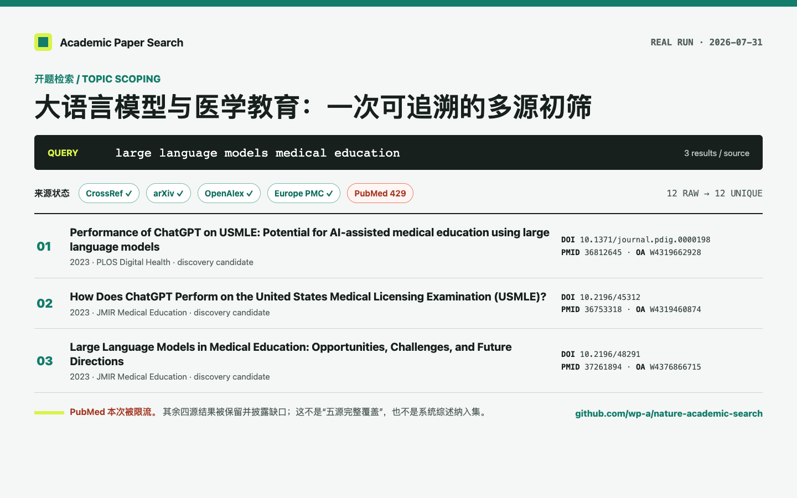
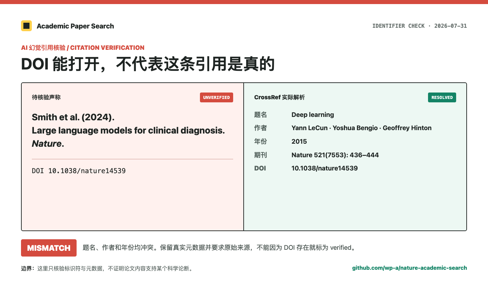
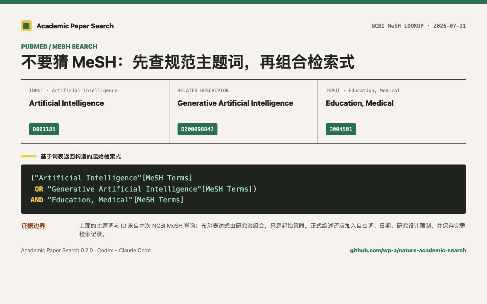

# Academic Paper Search

在 Codex 或 Claude Code 中用中文找论文，按 DOI 或 PMID 核对题名、作者、年份和期刊，再导出 Zotero 或 EndNote 可导入的引用文件。检索结果保留来源和失败记录，核验结果标出冲突和待复查字段。

[](https://github.com/wp-a/nature-academic-search/actions/workflows/ci.yml) [](https://pypi.org/project/nature-academic-search/) [](LICENSE)

[快速开始](#快速开始) · [实测案例](#实测案例) · [终端与批量任务](#终端与批量任务) · [文档](#文档)

## 快速开始

准备 Python 3.10+ 和 [uv](https://docs.astral.sh/uv/getting-started/installation/)。选择你正在使用的客户端，安装插件即可获得 Skill 和 MCP 服务配置。用到 PubMed 时，在启动客户端的环境中设置 `PUBMED_EMAIL`。 [环境配置与安装排查](docs/installation.md)

**Codex**

```bash
codex plugin marketplace add wp-a/nature-academic-search
codex plugin add nature-academic-search@wp-a-academic-tools
```

**Claude Code**

```bash
claude plugin marketplace add wp-a/nature-academic-search
claude plugin install nature-academic-search@wp-a-academic-tools
```

开启新会话，复制下面这条故意填错题名、作者和年份的引用。Codex 也支持用 `$nature-academic-search` 显式调用 Skill。

```text
使用 nature-academic-search 核验这条引用。按 DOI 查找元数据，逐项比较题名、
首位作者、年份和期刊，返回核验状态和来源。
Smith et al. (2024). Large language models for clinical diagnosis. Nature.
DOI: 10.1038/nature14539
```

**预期结果为 `mismatch`。** DOI 能解析，实际对应 Yann LeCun、Yoshua Bengio 和 Geoffrey Hinton 的 *Deep learning*（2015）。题名、作者和年份不符，期刊 `Nature` 一致。

```json
{
  "title": "Deep learning",
  "source": "crossref",
  "verification": { "status": "mismatch" }
}
```

这是 0.3.1 的输出节选。看到客户端调用工具并返回字段状态，即可确认核验已跑通。核验范围是书目元数据，引用研究结论时还需阅读原文。 [完整案例和历史截图](docs/examples/citation-verification.md)

## 实测案例

以下截图来自 **2026 年 7 月 31 日**的实测记录。点击图片可查看完整结果、当时的版本和来源状态。

<table>
  <tr>
    <td align="center" width="33%">
      <a href="docs/examples/topic-scoping.md"></a><br>
      <strong>开题检索</strong><br>
      候选论文、标识符和各来源的成功或限流状态。
    </td>
    <td align="center" width="33%">
      <a href="docs/examples/citation-verification.md"></a><br>
      <strong>引用核验</strong><br>
      DOI 查到了论文，题名、作者和年份却对不上。
    </td>
    <td align="center" width="33%">
      <a href="docs/examples/pubmed-mesh.md"></a><br>
      <strong>PubMed / MeSH</strong><br>
      已核对的主题词、MeSH ID 和起始检索式。
    </td>
  </tr>
</table>

[开题检索记录](docs/examples/topic-scoping.md) · [引用核验记录](docs/examples/citation-verification.md) · [PubMed / MeSH 记录](docs/examples/pubmed-mesh.md)

### 六个可复制的场景

引用核验见[快速开始](#快速开始)。展开下方任一场景即可复制提示词。

<details>
<summary>开题检索</summary>

```text
使用 nature-academic-search 检索“生成式 AI 在医学教育中的应用与风险”。
先写出英文检索式，再用默认论文源搜索，按 DOI、PMID 等标识符去重。
列出最多 10 条候选，区分正式论文与预印本，附 DOI 或 PMID，
并报告本次检索日期和各来源的成功、失败或限流状态。
```

</details>

<details>
<summary>PubMed / MeSH 检索</summary>

```text
使用 nature-academic-search 为“生成式 AI 与医学教育”设计 PubMed 起始检索式。
先核对 Artificial Intelligence、Generative Artificial Intelligence 和
Education, Medical 的规范主题词及 MeSH ID，再与题名和摘要中的自由词组合。
给出核词结果、完整检索式和仍需补充的同义词。
```

</details>

<details>
<summary>上下游引文追踪</summary>

```text
使用 nature-academic-search 解析 DOI 10.1038/nature14539，追踪一跳上下游引文。
分别列出它引用了哪些论文、哪些论文引用了它。保留每条关系的来源，
并报告查询失败或截断情况。将 citation_graph 保存为 graph.json。
```

</details>

<details>
<summary>综述整理与 RIS 导出</summary>

```text
使用 nature-academic-search 为“生成式 AI 在医学教育中的应用”拟定综述检索计划。
先列出数据库、检索式和纳入排除标准，等我确认后再检索。
按 DOI 或 PMID 核验候选，只将符合筛选条件且核验通过的记录导出为 RIS。
另列冲突和待人工复查的条目。
```

</details>

<details>
<summary>临床试验关联</summary>

```text
使用 nature-academic-search 检索 ClinicalTrials.gov 上与肺癌新辅助免疫治疗相关的注册。
按 NCT ID 列出试验状态、干预和申办方，并标出正在招募的记录。
若注册记录提供关联论文，单独核验论文的 PMID 或 DOI。
```

</details>

[更多命令和输出字段](docs/usage.md)

默认论文源包括 **CrossRef、PubMed、arXiv、OpenAlex 和 Europe PMC**。Semantic Scholar 可显式调用，ClinicalTrials.gov 单独查试验注册。项目未连接 Google Scholar、Web of Science、Scopus、Embase、CNKI、万方。界定系统综述的检索范围时，请根据研究方案补充所需数据库。 [各来源的覆盖与边界](references/source-tiers.md)

## 终端与批量任务

PyPI `0.3.1` 已提供 `search`、`verify`、引用转换和 YAML 工作流。下面可在终端复现首页的核验。

```bash
uv tool install nature-academic-search
nature-academic-search verify 10.1038/nature14539 \
  --expected-title "Large language models for clinical diagnosis" \
  --expected-authors "Smith" --expected-year 2024 --expected-journal "Nature"
```

批量任务可先保存检索计划，再运行检索、核验和 RIS 导出。流程保存来源状态及未导出的核验记录。如需模型辅助摘要初筛，可单独配置模型入口。 [CLI 与 MCP 用法](docs/usage.md) · [YAML 工作流与筛选](references/search-workflows.md#23-声明式科研工作流)

## 文档

| 文档 | 内容 |
|---|---|
| [安装与配置](docs/installation.md) | PyPI、源码、客户端插件、DeepSeek Harness Bundle 和排查 |
| [Skill 指令](SKILL.md) | 任务路由和证据规则 |
| [检索工作流](references/search-workflows.md) | 查询构造、过滤、去重和结果解释 |
| [引用文件](references/citation-files.md) | RIS、BibTeX、NBIB、ENW |
| [维护手册](docs/maintenance.md) | 测试、打包与发布流程 |

安装标识为 `nature-academic-search`。检索范围不限于 Nature 期刊，项目与 Nature Portfolio 无官方关联。

反馈问题时请附版本、最小查询和脱敏后的错误信息。 [提交 Issue](https://github.com/wp-a/nature-academic-search/issues)

[MIT License](LICENSE) · [TensorBlock MCP Server Directory](https://tensorblock.co/mcp/servers/github-wp-a-nature-academic-search-24b4493d)
